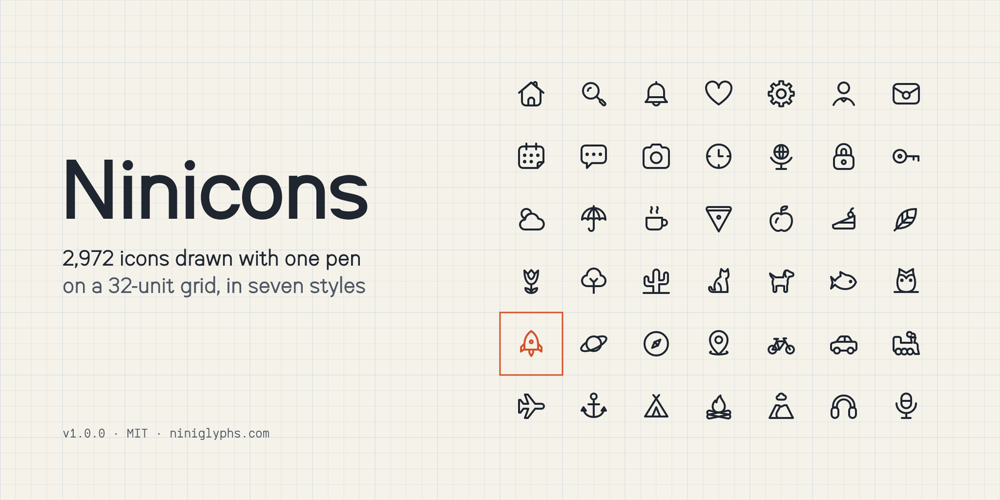
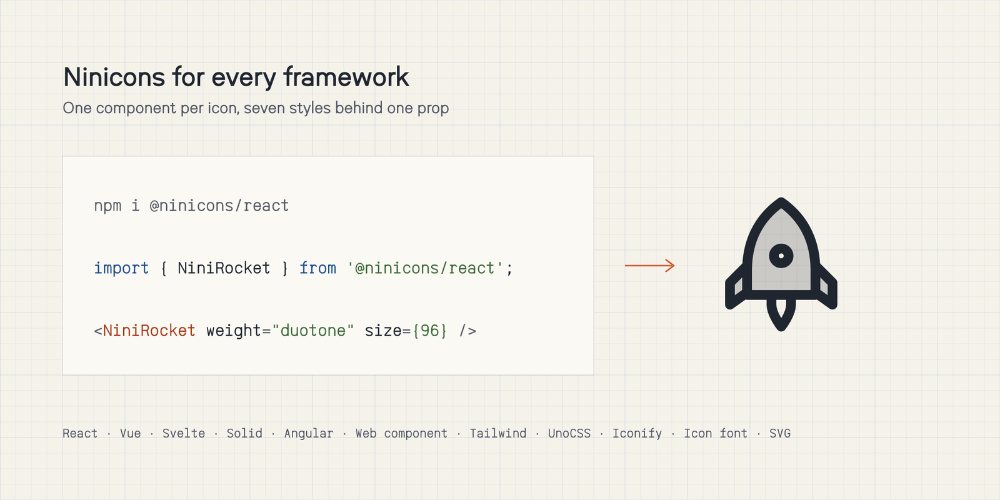
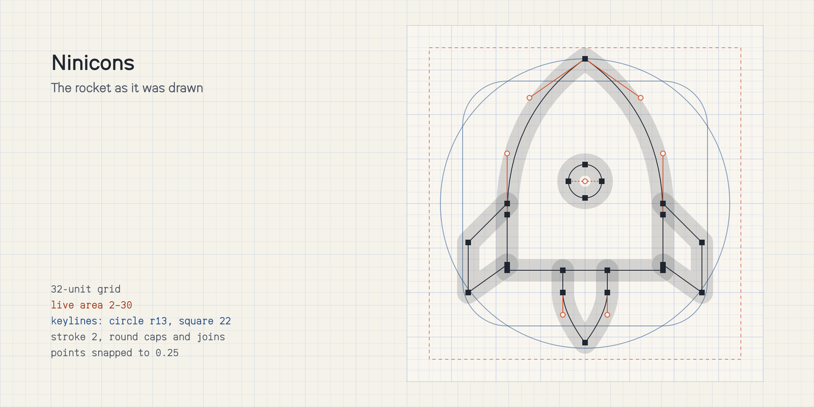

<picture>
  <source media="(prefers-color-scheme: dark)" srcset=".github/assets/hero-dark.png">
  
</picture>

<p align="center">
  <a href="https://niniglyphs.com"><b>Browse the icons</b></a> ·
  <a href="https://niniglyphs.com/use/">Install</a> ·
  <a href="examples">Examples</a> ·
  <a href="https://github.com/niniglyphs/ninicons/issues/new?template=request-an-icon.yml">Request an icon</a>
</p>

<p align="center">
  <a href="https://www.npmjs.com/package/@ninicons/core"></a>
  <a href="LICENSE"></a>
  
</p>

# Ninicons

2,972 icons, drawn by hand with one pen on a 32-unit grid, in seven styles: thin, light, regular, semibold,
bold, fill and duotone. Every icon is plain SVG in `currentColor`, with no masks or ids, so it takes the colour of
the text around it. MIT licensed: use them in anything, commercial or not.

```bash
npm i @ninicons/react
```

```jsx
import { NiniRocket } from '@ninicons/react';

<NiniRocket weight="duotone" size={32} />
```

## Packages

<picture>
  <source media="(prefers-color-scheme: dark)" srcset=".github/assets/packages-dark.png">
  
</picture>

Every package draws the same drawings and uses one name, `nini`. In HTML an icon is `nini-rocket`; in JavaScript,
where a name can't hold a hyphen, it is `NiniRocket`.

| | Package | |
|---|---|---|
| React, Preact, Next.js | [`@ninicons/react`](packages/react) | `<NiniRocket weight="bold" />` |
| Vue, Nuxt | [`@ninicons/vue`](packages/vue) | `<NiniRocket weight="bold" />` |
| Svelte 5, SvelteKit | [`@ninicons/svelte`](packages/svelte) | `<NiniRocket weight="bold" />` |
| Solid | [`@ninicons/solid`](packages/solid) | `<NiniRocket weight="bold" />` |
| Angular 17+ | [`@ninicons/angular`](packages/angular) | `<nini-icon [icon]="rocket" weight="bold" />` |
| HTML, any framework | [`@ninicons/web`](packages/web) | `<nini-icon name="rocket" weight="bold">` |
| Tailwind CSS, UnoCSS, Iconify | [`@ninicons/iconify`](packages/iconify) | `icon-[nini--rocket-bold]`, `i-nini-rocket-bold` |
| SVG files and sprites | [`@ninicons/core`](packages/core) | `svg/bold/rocket.svg` |
| Icon font | [`@ninicons/font`](packages/font) | `<i class="nini-bold nini-rocket">` |

Every package is checked before each release: every icon, in every style, is drawn through the package and compared
with the SVG files in [`svg/`](svg), 20,804 drawings per package.

## How they are drawn

<picture>
  <source media="(prefers-color-scheme: dark)" srcset=".github/assets/construction-dark.png">
  
</picture>

Each icon is drawn once, at regular, on a 32-unit grid. Ink stays inside the live area (2 to 30); round things sit
on a circle of radius 13 and square things on a 22-unit square, so every icon reads at the same size. The stroke
is 2 units with round caps and joins, and every point lands on a quarter unit. The other six styles are made from
that one drawing:

| Style | Stroke | |
|---|---|---|
| thin | 0.5 | |
| light | 1.5 | |
| regular | 2 | the drawing every other style comes from |
| semibold | 2.5 | |
| bold | 3 | |
| fill | | solid shapes, with the details knocked out |
| duotone | 2 | the regular drawing over a 20% tint |

The same pen draws two typefaces, [Nini Sans](https://github.com/niniglyphs/nini-sans) and
[Nini Mono](https://github.com/niniglyphs/nini-mono), and each of their weights has an icon style at the same
stroke, so an icon set at 1 em sits in a line of text as one more letter.

## Examples

[`examples/`](examples) builds the same small app with each package: React, Next.js, Vue, Svelte, Solid, Angular,
the web component, Tailwind CSS, UnoCSS, the sprites, the icon font and plain HTML. Each one opens in the browser,
on CodePen or StackBlitz, from [`examples/README.md`](examples/README.md).

## The files

- [`svg/<style>/<name>.svg`](svg): every icon as a plain SVG, in `currentColor`, with no masks or ids.
- [`icons.json`](icons.json): every icon's name, category, search tags and the release that added it.

## Missing an icon?

[Request one](https://github.com/niniglyphs/ninicons/issues/new?template=request-an-icon.yml). Found something
drawn wrong? [Tell us](https://github.com/niniglyphs/ninicons/issues/new?template=bug.yml).

The icons are drawn in a separate studio and released here, so pull requests to the drawings can't be merged; an
issue is the way to ask for a change. See [CONTRIBUTING.md](CONTRIBUTING.md).

## Licence

MIT. Use the icons in anything, commercial or not; no credit needed, though it is always welcome.

Ninicons is part of [Niniglyphs](https://niniglyphs.com), drawn by Sayantan Roy, with the typefaces
[Nini Sans](https://github.com/niniglyphs/nini-sans) and [Nini Mono](https://github.com/niniglyphs/nini-mono).
