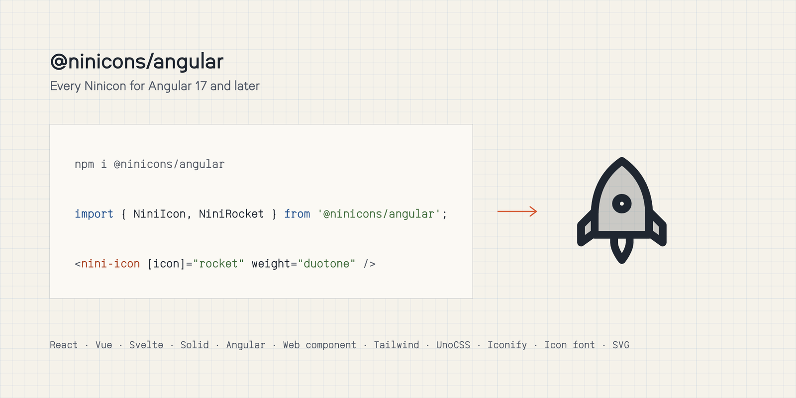

# @ninicons/angular

<picture>
  <source media="(prefers-color-scheme: dark)" srcset="https://raw.githubusercontent.com/niniglyphs/ninicons/main/.github/assets/packages/angular-dark.png">
  
</picture>

Every Ninicon for Angular 17 and later: one standalone `<nini-icon>` component and one constant per icon, seven
styles behind one `weight` input.

```bash
npm i @ninicons/angular
```

```ts
import { Component } from '@angular/core';
import { NiniIcon, NiniRocket } from '@ninicons/angular';

@Component({
  selector: 'app-launch',
  imports: [NiniIcon],
  template: `
    <nini-icon [icon]="rocket" />
    <nini-icon [icon]="rocket" weight="bold" [size]="32" />
    <nini-icon [icon]="rocket" weight="duotone" color="#d4502a" title="Launch" />
  `,
})
export class Launch {
  rocket = NiniRocket;
}
```

| Input | Default | |
|---|---|---|
| `icon` | | required: an icon constant such as `NiniRocket` |
| `weight` | `regular` | `thin` `light` `regular` `semibold` `bold` `fill` `duotone` |
| `size` | `24` | width and height, a number of pixels or any CSS length |
| `color` | `currentColor` | follows the text colour unless set |
| `title` | | a label for screen readers; without one the icon is `aria-hidden` |

Works with server rendering and hydration. Your build keeps only the icon constants you import.

Names are the icon's name in PascalCase after `Nini`: `arrow-right` is `NiniArrowRight`. Browse them all at
[niniglyphs.com](https://niniglyphs.com).

MIT licensed.
