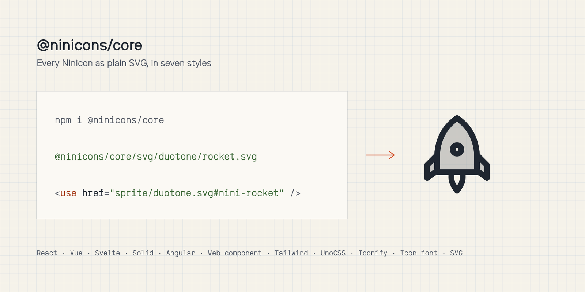

# @ninicons/core

<picture>
  <source media="(prefers-color-scheme: dark)" srcset="https://raw.githubusercontent.com/niniglyphs/ninicons/main/.github/assets/packages/core-dark.png">
  
</picture>

Every Ninicon as a plain SVG file, in seven styles:

| Style | Path |
|---|---|
| thin, light, regular, semibold, bold | `svg/<style>/<name>.svg` (stroke width 0.5 / 1.5 / 2 / 2.5 / 3) |
| fill | `svg/fill/<name>.svg` |
| duotone | `svg/duotone/<name>.svg` (a 20% tint behind the regular drawing) |

Every file draws in `currentColor` on a 32-unit grid and uses no masks or ids, so icons can be inlined any number
of times on one page.

Each style is also one sprite, `sprite/<style>.svg`, with every icon as `<symbol id="nini-<name>">`:

```html
<svg width="24" height="24"><use href="/sprite/regular.svg#nini-rocket"/></svg>
```

`icons.json` lists the styles, the categories and every icon's name and category.

```bash
npm i @ninicons/core
```

```js
import rocket from '@ninicons/core/svg/regular/rocket.svg';
```

MIT licensed.
