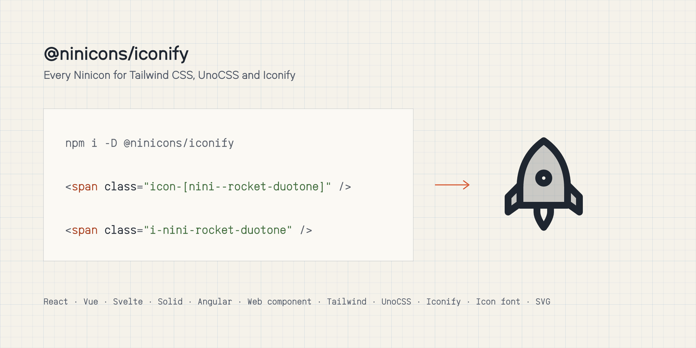

# @ninicons/iconify

<picture>
  <source media="(prefers-color-scheme: dark)" srcset="https://raw.githubusercontent.com/niniglyphs/ninicons/main/.github/assets/packages/iconify-dark.png">
  
</picture>

Every Ninicon as one [Iconify](https://iconify.design) collection, prefix `nini`, for the tools that read IconifyJSON:
Tailwind CSS and UnoCSS icon plugins, Astro Icon, Iconify's components.

| Name | Style |
|---|---|
| `nini:rocket` (or `nini:rocket-regular`) | regular |
| `nini:rocket-thin` `-light` `-semibold` `-bold` | the other stroke weights |
| `nini:rocket-fill` `nini:rocket-duotone` | fill and duotone |

```bash
npm i -D @ninicons/iconify
```

## UnoCSS

```js
// uno.config.js
import { defineConfig, presetIcons } from 'unocss';

export default defineConfig({
  presets: [presetIcons({ collections: { nini: () => import('@ninicons/iconify/icons.json').then((m) => m.default) } })],
});
```

```html
<span class="i-nini-rocket"></span>
<span class="i-nini-rocket-bold text-2xl text-orange-600"></span>
```

## Tailwind CSS 4

The plugin reads a collection by file path, from the folder Tailwind runs in:

```css
@import 'tailwindcss';
@plugin '@iconify/tailwind4' {
  icon-sets: from-json(nini, './node_modules/@ninicons/iconify/dist/icons.json');
}
```

```html
<span class="icon-[nini--rocket]"></span>
<span class="icon-[nini--rocket-bold] text-2xl text-orange-600"></span>
```

Only the icons a page uses are generated.

## Anything else

```js
import { icons } from '@ninicons/iconify'; // IconifyJSON
```

The package also carries `info.json` and `metadata.json` (categories), like Iconify's own `@iconify-json/*` sets.

MIT licensed.
