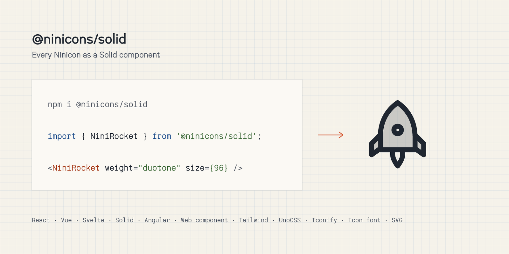

# @ninicons/solid

<picture>
  <source media="(prefers-color-scheme: dark)" srcset="https://raw.githubusercontent.com/niniglyphs/ninicons/main/.github/assets/packages/solid-dark.png">
  
</picture>

Every Ninicon as a Solid component. One component per icon, seven styles behind one `weight` prop.

```bash
npm i @ninicons/solid
```

```jsx
import { NiniRocket } from '@ninicons/solid';

<NiniRocket />
<NiniRocket weight="bold" size={32} />
<NiniRocket weight="duotone" color="#d4502a" title="Launch" />
```

| Prop | Default | |
|---|---|---|
| `weight` | `regular` | `thin` `light` `regular` `semibold` `bold` `fill` `duotone` |
| `size` | `24` | width and height, a number of pixels or any CSS length |
| `color` | `currentColor` | follows the text colour unless set |
| `title` | | a label for screen readers; without one the icon is `aria-hidden` |

Any other prop goes to the `<svg>`, and every prop stays reactive. Works with SolidStart and server rendering;
bundlers keep only the icons you import, or import one by its path: `import { NiniRocket } from '@ninicons/solid/icons/rocket'`.

Names are the icon's name in PascalCase after `Nini`: `arrow-right` is `NiniArrowRight`. Browse them all at
[niniglyphs.com](https://niniglyphs.com).

MIT licensed.
